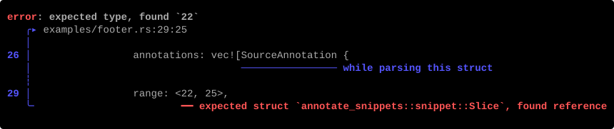

# annotate-snippets

> Format diagnostic reports, including highlighting snippets of text

[][Documentation]

## License

Licensed under either of

* Apache License, Version 2.0, ([LICENSE-APACHE](LICENSE-APACHE) or <https://www.apache.org/licenses/LICENSE-2.0>)
* MIT license ([LICENSE-MIT](LICENSE-MIT) or <https://opensource.org/license/mit>)

at your option.

[Documentation]: https://docs.rs/annotate-snippets/
